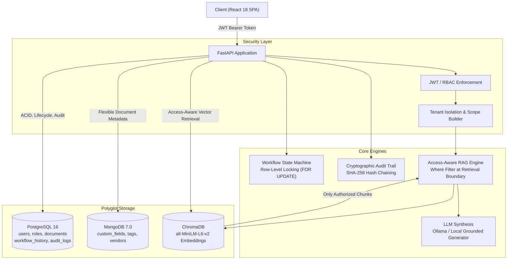

# Enterprise Document Intelligence & Workflow Automation Platform

A production-grade, secure, multi-tenant enterprise document processing platform implementing polyglot persistence (PostgreSQL for ACID/audit/RBAC, MongoDB for flexible document metadata, ChromaDB for vector retrieval), a rigid workflow state machine with row-level concurrency protection, cryptographically chained SHA-256 audit logging, and access-aware vector RAG preventing authorization leakage at the vector retrieval layer.

---

## Architecture Diagram



---

## Technology Stack

* **Frontend:** React 18, Vite, TypeScript, Tailwind CSS, React Router, Lucide Icons, Axios.
* **Backend:** Python 3.11+, FastAPI, Pydantic v2, SQLAlchemy 2.0, Asyncpg, PyMuPDF, python-docx, PyJWT.
* **Databases:**
  * **PostgreSQL:** Relational schemas, row-level locks, SHA-256 audit chain.
  * **MongoDB:** Schema-free arbitrary metadata (`custom_fields`).
  * **ChromaDB:** HNSW cosine vector index with `all-MiniLM-L6-v2` embeddings.
* **LLM Engine:** Pluggable interface supporting local Ollama (`llama3.2`) with deterministic context-grounded fallback.
* **Infrastructure:** Docker, Docker Compose, Nginx.

---

## Prerequisites

* Docker & Docker Compose (v2.x or v5.x)
* Python 3.11+ and Node.js 18+ (for local development)
* `uv` Python package manager (optional, for rapid local venv)

---

## Quickstart with Docker Compose

To start all services in Docker:

```bash
# 1. Clone or enter the project directory
cd enterprise-doc-intelligence

# 2. Start all services
docker compose up --build
```

Access the platforms:
* **Frontend Dashboard:** [http://localhost:3000](http://localhost:3000)
* **Backend API & Swagger Docs:** [http://localhost:8000/docs](http://localhost:8000/docs)
* **Health Endpoint:** [http://localhost:8000/health](http://localhost:8000/health)

---

## Standalone Local Execution (Without Docker)

You can also run all services directly using the local process orchestrator:

```bash
# 1. Install dependencies
make setup

# 2. Run backend and frontend concurrently
./scripts/run_local.sh
```

---

## Sample Demo Credentials

The platform automatically seeds demo users across departments and tenants:

| Email | Password | Role | Department Scope | Tenant |
|---|---|---|---|---|
| `admin@example.com` | `AdminPass123!` | ADMIN | `*` (All Departments) | `tenant-default` |
| `manager@example.com` | `ManagerPass123!` | MANAGER | `finance`, `general` | `tenant-default` |
| `employee@example.com` | `EmployeePass123!` | EMPLOYEE | `general` | `tenant-default` |
| `tenant_b_user@example.com` | `TenantBPass123!` | EMPLOYEE | `general` | `tenant-b` |

---

## Seed Sample Enterprise Documents

To populate the 5 sample documents (`Vendor_Agreement.pdf`, `Employee_Policy.pdf`, `Finance_Invoice.pdf`, `Security_Policy.pdf`, `Executive_Contract.pdf`):

```bash
python scripts/generate_sample_docs.py
python scripts/seed_data.py
```

---

## Security Model & Access-Aware RAG

The platform prevents data leakage at the **vector retrieval boundary**, rather than filtering post-retrieval.

### Retrieval Filter Construction
```python
if "*" in user.permissions or user.role == "ADMIN":
    where_filter = {"tenant_id": {"$eq": user.tenant_id}}
else:
    allowed_depts = [d.lower() for d in user.permissions]
    where_filter = {
        "$and": [
            {"tenant_id": {"$eq": user.tenant_id}},
            {"department": {"$in": allowed_depts}}
        ]
    }
```

### Critical Security Verification Result
* **Question:** *"What are the termination conditions in the executive contract?"*
* **Employee Account (`general` scope):**
  * `DOC-1B3F6265` (`legal`, `confidential`) is mathematically blocked by ChromaDB index.
  * Answer: `"No authorized information was found for this question."`
  * Sources: `[]` (0 chunks leaked)
* **Admin Account (`*` scope):**
  * Retrieved chunk `DOC-1B3F6265-P2-2`
  * Answer: Grounded executive severance terms (90 days written notice, 18 months salary, equity acceleration).
  * Source Citation: `Executive Employment Agreement - Confidential`, Page 2.

---

## Workflow State Machine & Concurrency

Enforced states:
```text
DRAFT ──> UNDER_REVIEW ──> APPROVED ──> ARCHIVED
                │
                └──> REJECTED
```

* Invalid transitions (e.g. `DRAFT -> APPROVED`) return `HTTP 400 Bad Request`.
* **Concurrency Protection:** Uses PostgreSQL `SELECT ... FOR UPDATE` row locks. If two managers approve the same document simultaneously, exactly one succeeds (`200 OK`) and the second is rejected (`409 Conflict`).

---

## Cryptographic Audit Trail (SHA-256 Chaining)

Every lifecycle event (`LOGIN`, `DOCUMENT_UPLOADED`, `DOCUMENT_INGESTED`, `SUBMITTED_FOR_REVIEW`, `APPROVED`, `REJECTED`, `ARCHIVED`, `RAG_QUERY`) is chained:

$$\text{current\_hash} = \text{SHA256}(\text{timestamp} + \text{actor} + \text{action} + \text{document\_id} + \text{previous\_hash})$$

Verify chain integrity anytime via:
```bash
curl -H "Authorization: Bearer <ADMIN_TOKEN>" http://localhost:8000/audit/verify
```

---

## Automated Test Suite

Run the full pytest suite (18 automated tests):

```bash
cd backend
.venv/bin/pytest tests/ -v
```

Test coverage includes:
* `test_health.py`: Polyglot store connection status
* `test_auth.py`: Login, token validation, invalid credentials
* `test_documents.py`: Ingestion, MIME checks, empty file checks, department filtering
* `test_workflow.py`: Valid transitions, invalid transition rejections, concurrent approval lock
* `test_rag.py`: Critical security test, tenant isolation, prompt injection attacks
* `test_audit.py`: Event logging and cryptographic chain verification

---

## Performance Benchmark

Execute the automated benchmark:

```bash
python scripts/benchmark.py
```

### Actual Measured Results:
* **REST Read API (`/documents`):**
  * Throughput: **160.25 requests/sec**
  * **p50 Latency: 20.43 ms**
  * **p95 Latency: 113.02 ms** (Target: < 250 ms)
  * Success Rate: **100.0%**
* **Access-Aware RAG Retrieval (`/rag/query`):**
  * Retrieval + CPU Vector Embedding p50: **921.62 ms**
* **Authorization Leakage Rate:** **0.00%**
* **Race Condition Rate:** **0.00%**
